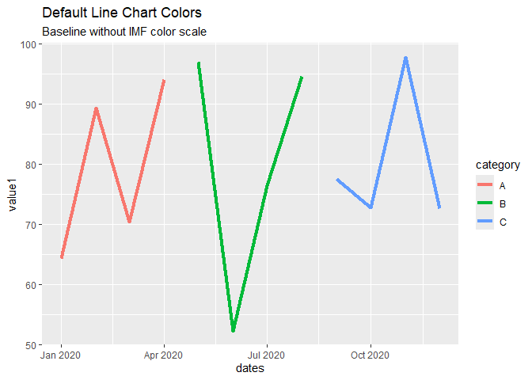
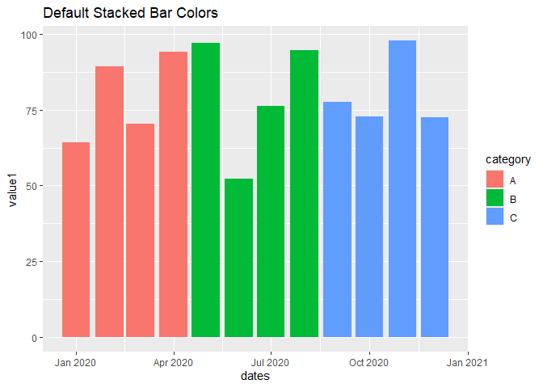
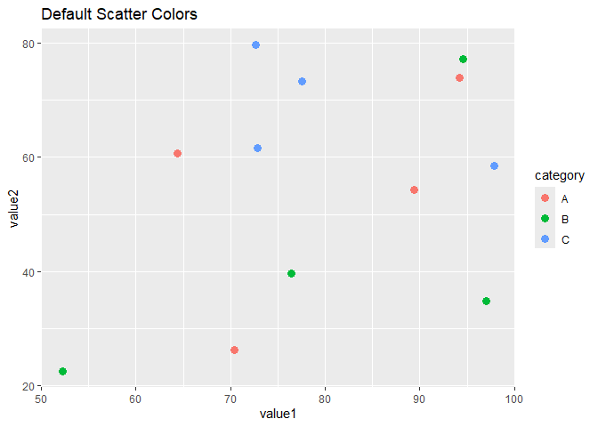
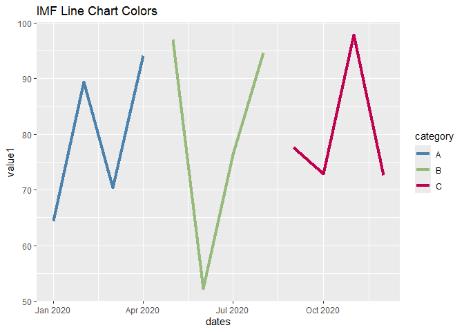
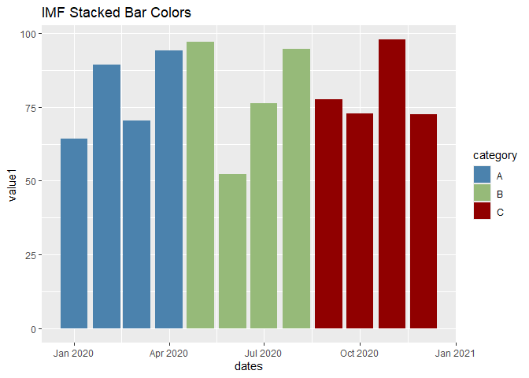
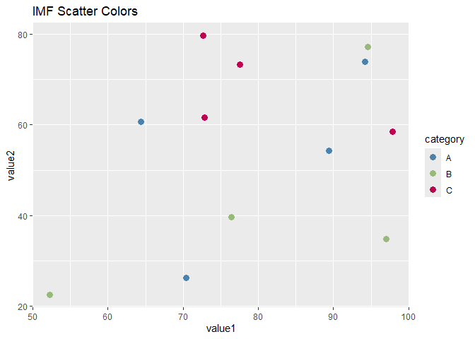
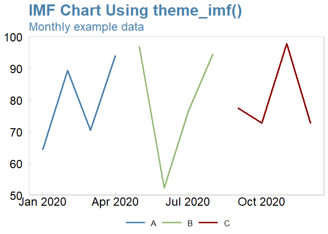
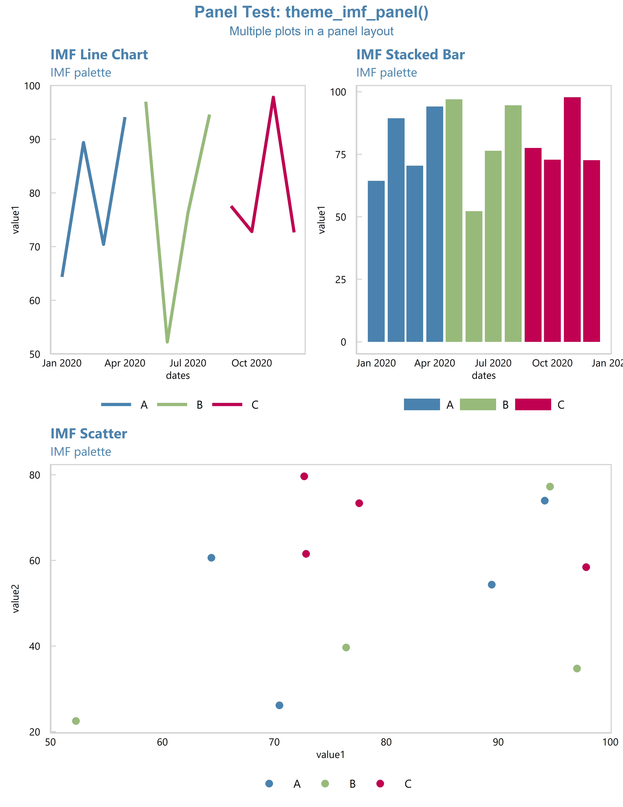
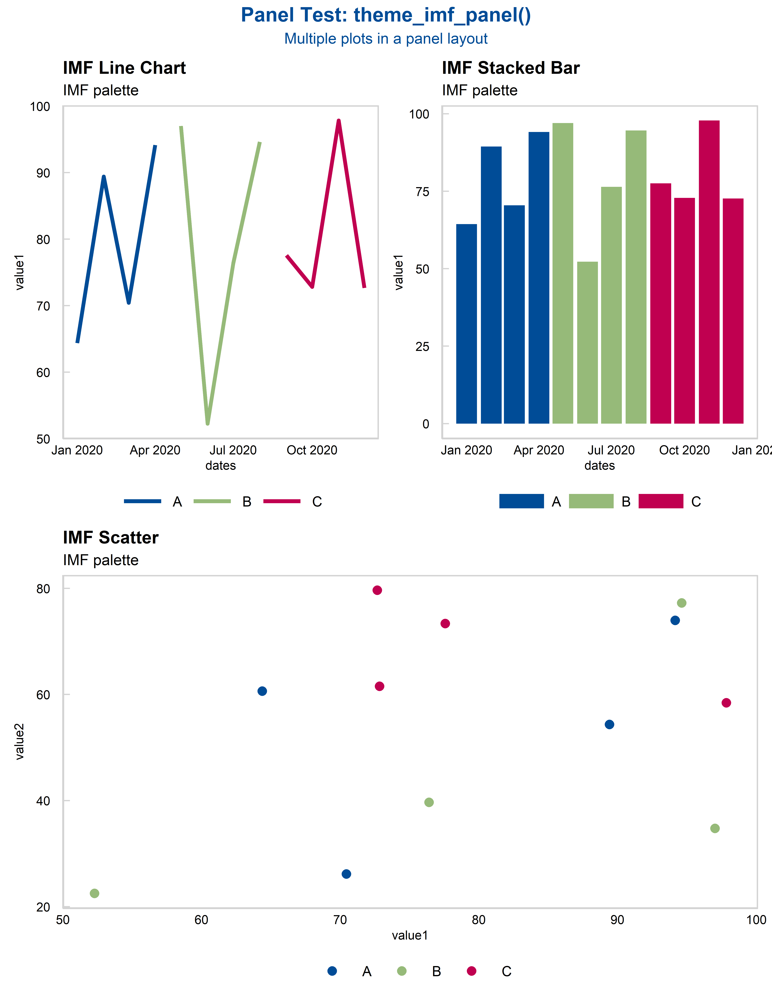

# imfbookr


`imfbookr` provides helper functions to produce ggplot charts with IMF
themes.

<table data-quarto-postprocess="true">
<colgroup>
<col style="width: 100%" />
</colgroup>
<tbody>
<tr>
<td data-bgcolor="#f2f2f2"><h3
id="new-imf-staff-report-chart-themes-2027">New IMF Staff Report Chart
Themes (2027)</h3>
<p>The IMF has introduced new themes for charts in staff reports. The
main changes are:</p>
<ul>
<li><strong>Font:</strong> Arial replaces Segoe UI.</li>
<li><strong>Chart titles:</strong> Titles are now black rather than
blue.</li>
<li><strong>Blue color:</strong> The previous IMF blue has been replaced
by a different shade of blue.</li>
</ul>
<p>To use the new themes, replace <code>theme_imf()</code> and
<code>theme_imf_panel()</code> with <code>theme_imf_2027()</code> and
<code>theme_imf_panel_2027()</code>, respectively. The new blue is
available as <code>imfblue_2027</code>.</p>
<p>The previous themes remain available for charts using the earlier
style.</p></td>
</tr>
</tbody>
</table>

------------------------------------------------------------------------

## Installing `imfbookr`

Install `remotes` if needed, then install `imfbookr` from GitHub:

``` r
if (!requireNamespace("remotes", quietly = TRUE)) {
  install.packages("remotes")
}

remotes::install_github("BasBBakkerIMF/imfbookr")
```

If direct GitHub installation is blocked on your computer, download the
source archive and install it locally instead:

``` r
if (!requireNamespace("remotes", quietly = TRUE)) {
  install.packages("remotes")
}

if (!requireNamespace("curl", quietly = TRUE)) {
  install.packages("curl")
}

url <- "https://codeload.github.com/BasBBakkerIMF/imfbookr/tar.gz/HEAD"
tf  <- tempfile(fileext = ".tar.gz")

curl::curl_download(url, tf)
remotes::install_local(tf)
```

After installation, load the package with:

``` r
library(imfbookr)
```

## Features

- Predefined **IMF color palettes** for charts.
- Custom **ggplot2 themes** (e.g., `theme_imf_panel()`).

## Usage

The following examples demonstrate how to use `imfbookr` functions to
quickly generate IMF-style charts. We first create some example data,
then compare default `ggplot2` styling with the custom IMF palette and
themes.

## IMF Color Palettes

The package includes a set of predefined color constants and palettes
consistent with IMF/WEO visual standards. You can use these colors
directly in plots or via helper scales like `scale_imf_colors()`.

### Quick start (example data)

To illustrate functionality, we generate a simple dataset with 12 months
of values across three categories:

``` r
library(imfbookr)
library(ggplot2)

set.seed(123)
test_data <- data.frame(
  dates    = seq(as.Date("2020-01-01"), by = "month", length.out = 12),
  category = rep(c("A", "B", "C"), each = 4),
  value1   = runif(12, 50, 100),
  value2   = runif(12, 20, 80)
)
```

Before applying IMF-specific functions, here’s what the default ggplot2
output looks like for a line, bar, and scatter chart.

``` r
# Line
ggplot(test_data, aes(dates, value1, color = category)) +
  geom_line(linewidth = 1.5) +
  labs(title = "Default Line Chart Colors",
       subtitle = "Baseline without IMF color scale")
```



``` r
# Stacked bar
ggplot(test_data, aes(dates, value1, fill = category)) +
  geom_bar(stat = "identity", position = "stack") +
  labs(title = "Default Stacked Bar Colors")
```



``` r
# Scatter
ggplot(test_data, aes(value1, value2, color = category)) +
  geom_point(size = 3) +
  labs(title = "Default Scatter Colors")
```



Now we apply the IMF color palette using `scale_imf_colors()`. This
ensures all charts use standardized IMF colors.

``` r
# Line with IMF colors
ggplot(test_data, aes(dates, value1, color = category)) +
  geom_line(linewidth = 1.5) +
  scale_imf_colors() +
  labs(title = "IMF Line Chart Colors")
```



``` r
# Stacked bar with IMF colors
ggplot(test_data, aes(dates, value1, fill = category)) +
  geom_bar(stat = "identity", position = "stack") +
  scale_imf_colors() +
  labs(title = "IMF Stacked Bar Colors")
```



``` r
# Scatter with IMF colors
ggplot(test_data, aes(value1, value2, color = category)) +
  geom_point(size = 3) +
  scale_imf_colors() +
  labs(title = "IMF Scatter Colors")
```



## IMF Chart Themes

Use `theme_imf()` for a standalone chart. It applies the standard IMF
formatting to the plot, while `scale_imf_colors()` controls the series
colors.

``` r
ggplot(test_data, aes(dates, value1, color = category)) +
  geom_line(linewidth = 1.2) +
  scale_imf_colors() +
  labs(
    title = "IMF Chart Using theme_imf()",
    subtitle = "Monthly example data",
    x = NULL,
    y = "Value"
  ) +
  theme_imf()
```



For multi-chart presentations, use `theme_imf_panel()` with `patchwork`
to apply consistent panel formatting to the individual charts. This
optional package is needed only for the panel example:

``` r
install.packages("patchwork")
```

The following example combines three charts into one figure.

``` r
library(patchwork)

p1 <- ggplot(test_data, aes(dates, value1, color = category)) +
  geom_line(linewidth = 1.5) +
  scale_imf_colors() +
  labs(title = "IMF Line Chart", subtitle = "IMF palette")+
  theme_imf_panel()

p2 <- ggplot(test_data, aes(dates, value1, fill = category)) +
  geom_bar(stat = "identity", position = "stack") +
  scale_imf_colors() +
  labs(title = "IMF Stacked Bar", subtitle = "IMF palette")+
   theme_imf_panel()

p3 <- ggplot(test_data, aes(value1, value2, color = category)) +
  geom_point(size = 3) +
  scale_imf_colors() +
  labs(title = "IMF Scatter", subtitle = "IMF palette")+
   theme_imf_panel()

(p1 | p2) / p3 +
  plot_annotation(
    title = "Panel Test: theme_imf_panel()",
    subtitle = "Multiple plots in a panel layout",
    theme=theme_imf_panel_title()
  ) 
```



With the new themes:

``` r
p1 <- ggplot(test_data, aes(dates, value1, color = category)) +
  geom_line(linewidth = 1.5) +
  scale_imf_colors_2027() +
  labs(title = "IMF Line Chart", subtitle = "IMF palette")+
  theme_imf_panel_2027()

p2 <- ggplot(test_data, aes(dates, value1, fill = category)) +
  geom_bar(stat = "identity", position = "stack") +
  scale_imf_colors_2027() +
  labs(title = "IMF Stacked Bar", subtitle = "IMF palette")+
  theme_imf_panel_2027()

p3 <- ggplot(test_data, aes(value1, value2, color = category)) +
  geom_point(size = 3) +
  scale_imf_colors_2027() +
  labs(title = "IMF Scatter", subtitle = "IMF palette")+
  theme_imf_panel_2027()

(p1 | p2) / p3 +
  plot_annotation(
    title = "Panel Test: theme_imf_panel()",
    subtitle = "Multiple plots in a panel layout",
    theme = theme_imf_panel_title_2027()
  )
```


